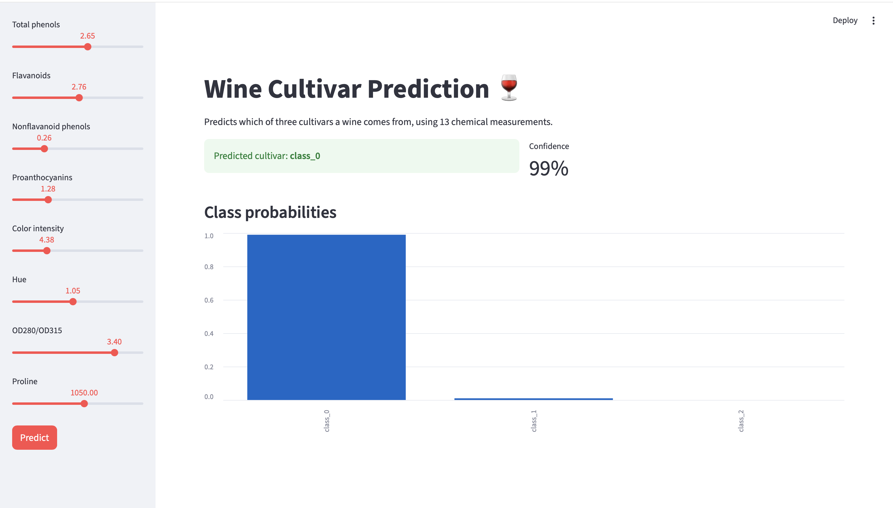
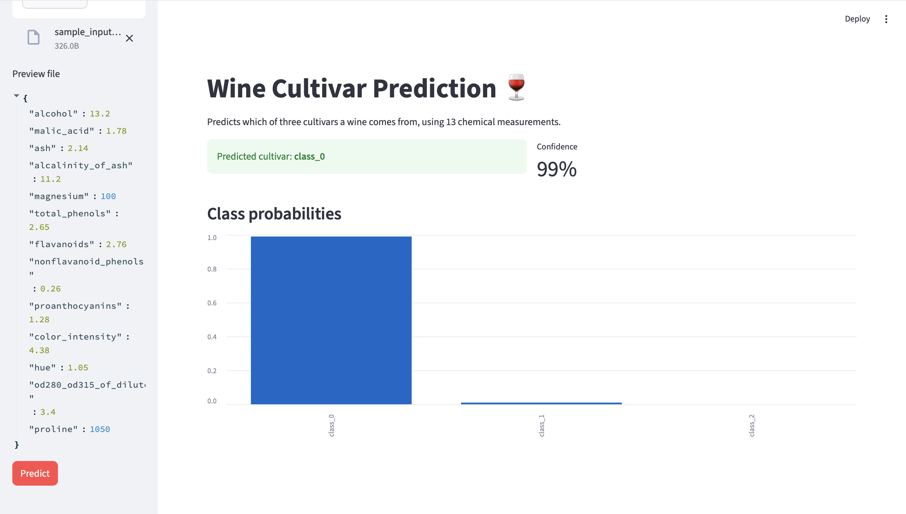
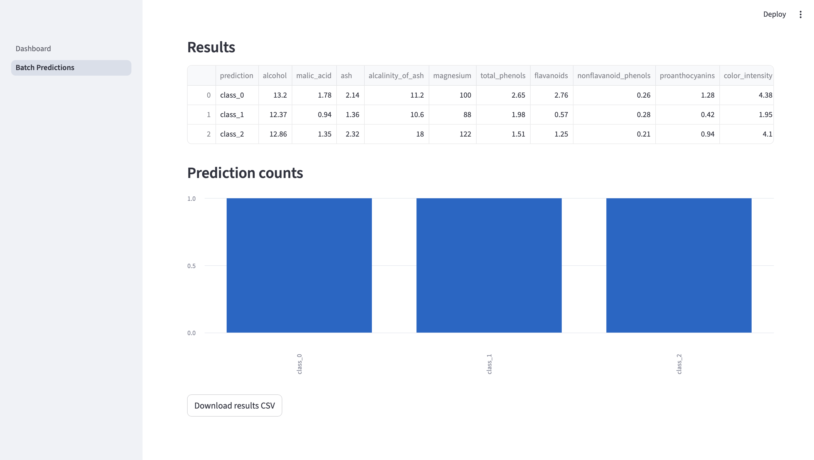
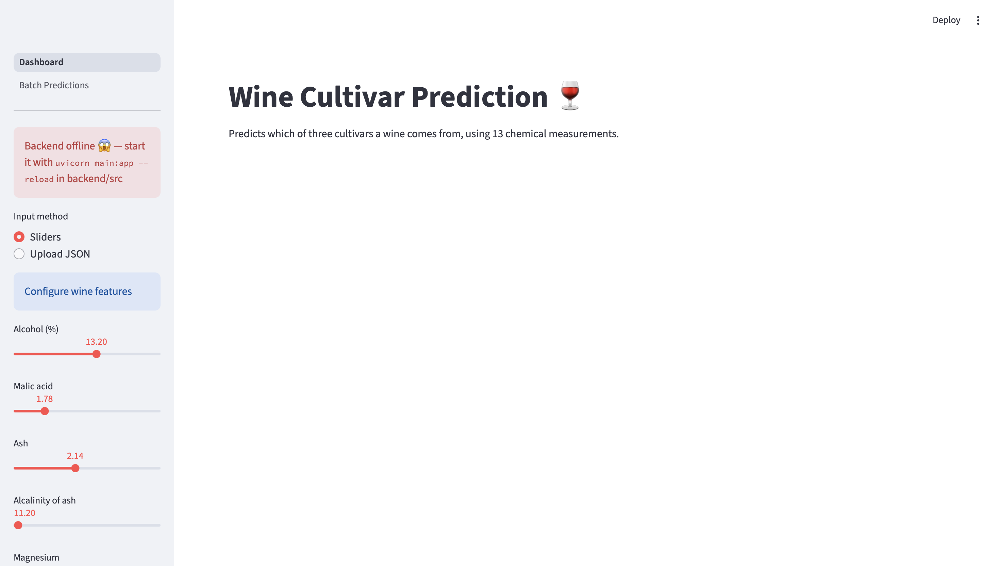

# Lab Assignment 3: Streamlit Wine Classifier Dashboard

**Author:** Rutvij Surti

Modified version of the [Streamlit Lab](https://github.com/raminmohammadi/MLOps/tree/main/Labs/API_Labs/Streamlit_Labs) from the MLOps course at Northeastern University.

## Overview
An interactive Streamlit dashboard for a wine cultivar classifier. The frontend sends requests to a FastAPI backend that serves a Random Forest model trained on the scikit-learn Wine dataset. The backend is my modified [FastAPI Lab](https://github.com/rutvijsurti/mlops-lab1-fastapi), included here in `backend/` so this repo runs on its own.

## Changes from the Original Lab

| Area | Original | This Version |
|---|---|---|
| Backend | Iris FastAPI lab (4 features, Decision Tree) | Wine FastAPI backend (13 features, Random Forest) with `/model-info` endpoint |
| Input | JSON upload only (sliders commented out) | Choose between 13 sliders (Wine data ranges) or JSON upload |
| Output | Text with predicted class | Predicted class, confidence metric, and class-probability bar chart |
| Sidebar | Backend health check | Health check plus live model type and test accuracy |
| Pages | Single page | Adds a **Batch Predictions** page: upload a CSV, predict every row, view counts chart, download results |
| Error handling | Generic toast on failure | Shows backend 422 validation details; clear offline messages |

## Project Structure
```
├── assets/                        # Screenshots
├── backend/
│   ├── model/
│   │   └── wine_model.pkl
│   └── src/
│       ├── __init__.py
│       ├── data.py
│       ├── main.py                # FastAPI app
│       ├── predict.py
│       └── train.py
├── data/
│   ├── sample_input.json          # Single prediction for JSON upload
│   └── sample_batch.csv           # Rows for the batch page
├── frontend/
│   ├── Dashboard.py               # Main Streamlit page
│   └── pages/
│       └── 1_Batch_Predictions.py
├── requirements.txt
└── README.md
```

## Setup
```bash
python3 -m venv venv
source venv/bin/activate   # Windows: venv\Scripts\activate
pip install -r requirements.txt
```

## Run
The app needs two servers running at the same time, each in its own terminal.

**Terminal 1: FastAPI backend (port 8000)**
```bash
cd backend/src
python train.py            # optional: retrain the model
uvicorn main:app --reload
```

**Terminal 2: Streamlit frontend (port 8501)**
```bash
streamlit run frontend/Dashboard.py
```
The dashboard opens at http://localhost:8501.

## Screenshots

**Single prediction with sliders**


**Single prediction from uploaded JSON**


**Batch predictions from CSV**


**Backend offline handling**

